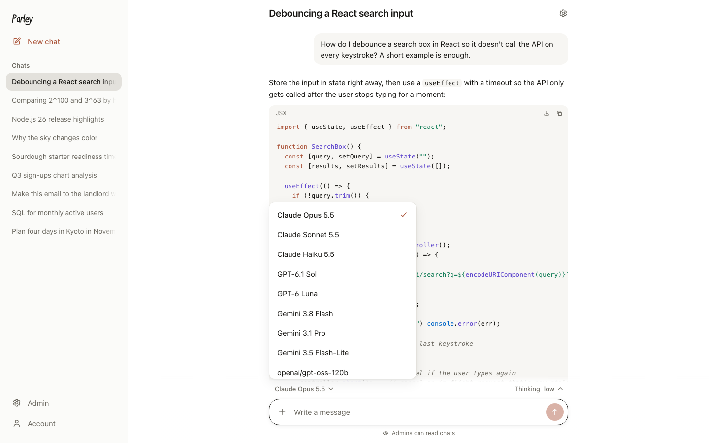
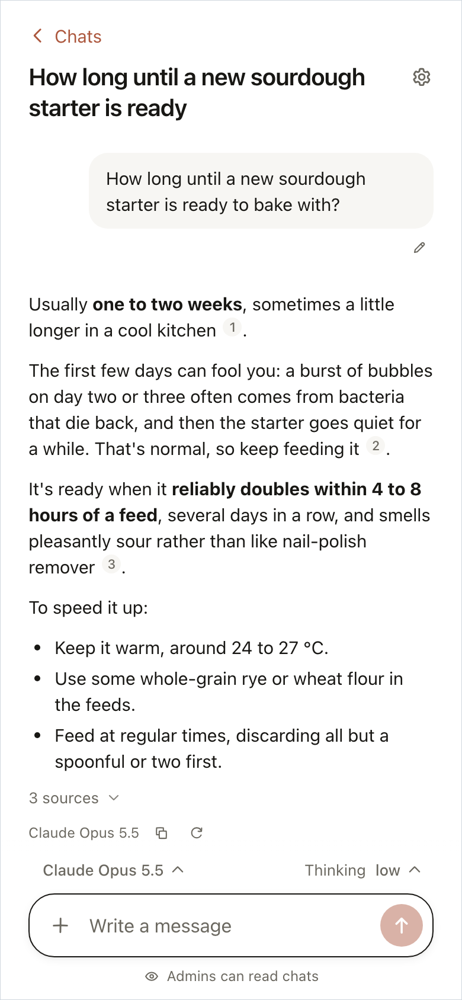
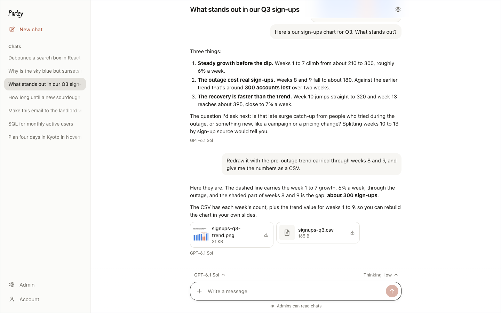
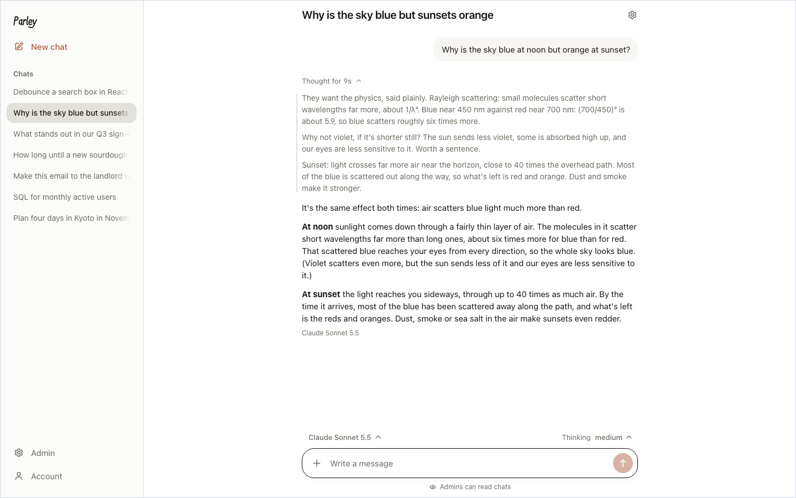
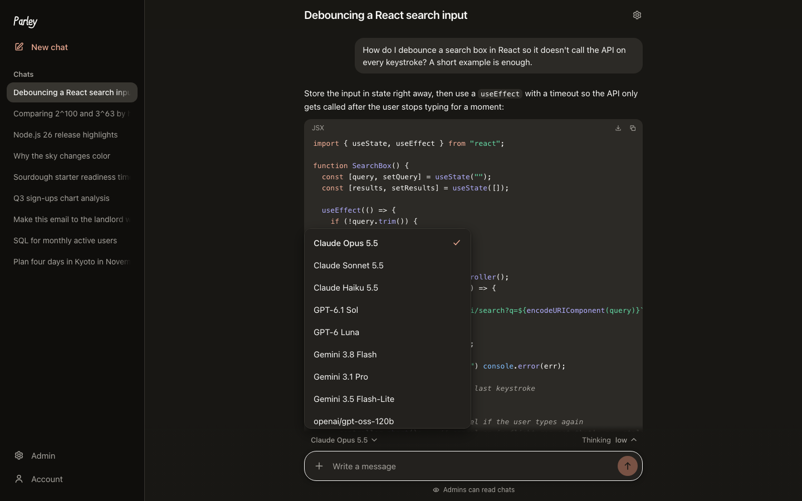
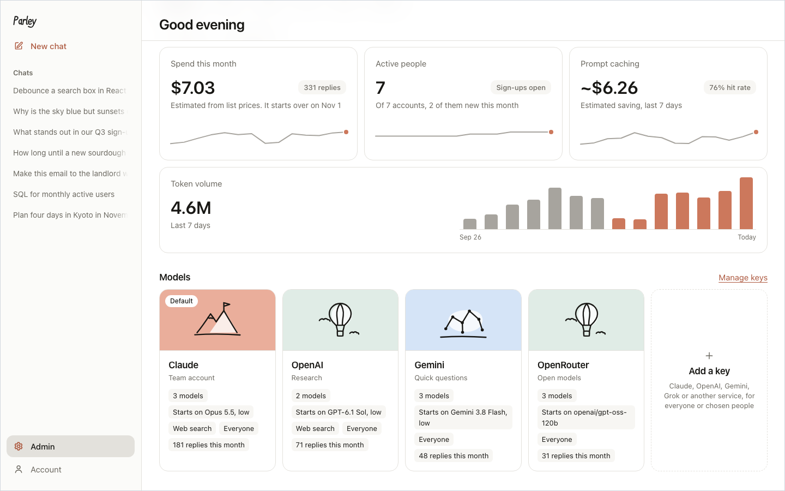
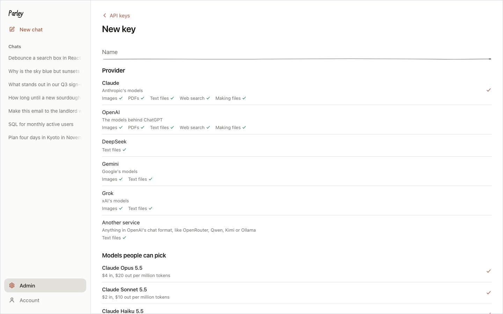
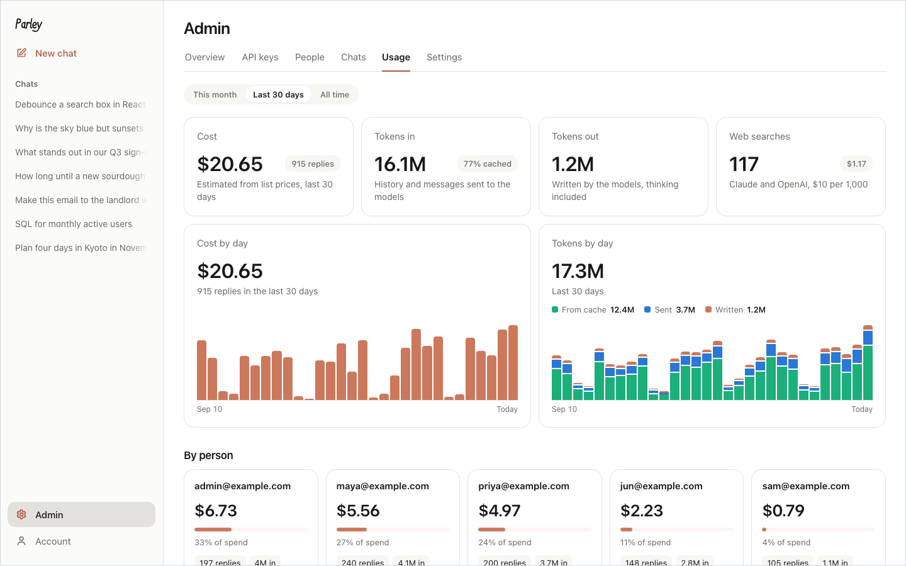

# Parley

[English](README.md)

一个可以自己部署的 AI 聊天网站，适合团队、班级或家人一起用。管理员填入 Claude、OpenAI、Gemini、Grok、DeepSeek 或任何兼容 OpenAI 聊天格式的服务的 API key，决定谁能用哪些模型、每月能花多少；其他人登录后直接聊天。API key 只存在服务器上，不会发到浏览器。

前端用 Vite + React，后端用 Node 上的 Hono，数据存在 SQLite（Node 自带的 `node:sqlite`）里。一个进程，一个数据文件夹。

## 截图

<p align="center">
  
  
</p>
<p align="center">
  
  
</p>
<p align="center">
  
  
</p>
<p align="center">
  
  
</p>

## 能做什么

**聊天的人**
- 在管理员开放的模型里选模型和思考强度，每个聊天单独设置。
- 选择两个或三个模型回答同一个问题和附件，并排查看流式回复，单独停止或重试，再选择其中一个回答继续聊天
- 定时运行提示词，支持单次、每天和每周指定日期，选择模型和时区，暂停或恢复计划，立即运行，并从运行记录打开保存的回答
- 上传图片、PDF 和文本文件。每个模型能读什么就读什么，读不了时输入框下方会提示。
- 对公开推理过程的模型，回复上方可以展开看它的思考。
- 管理员开启后，Claude 和 OpenAI 的模型可以联网搜索并标出来源，也可以运行代码生成文件供下载。其他模型通过管理员选的搜索服务联网搜索、阅读网页，也可以生成 CSV 表格、网页、笔记、代码等文本文件供下载。
- AI 拿不准时会先问你：回复写到一半，它可以在回复里用一行提出问题并给几个选项，你选一个或写下自己的回答，它就接着往下写。
- 先做计划，每个聊天单独设置：AI 先列出步骤，你可以修改、批准或退回，批准后它在回复里边做边勾掉每一步。
- 编辑已发的消息或重新生成回复，之前的版本不会丢。
- 给所有聊天或单个聊天设置说明（关于你、希望怎么回答）。
- 用项目整理聊天：项目像文件夹，有自己的说明和知识库，里面每个聊天都共用。
- 把 PDF、Word 文档和文本文件放进知识库，连到聊天或项目上，所有模型都能在里面查资料。
- 记忆：AI 会在聊天之间记下关于你的简短笔记，你可以查看、修改、添加，也可以关掉。
- 有些服务的工具按每个人自己的账号行事。在「设置」的「已连接的服务」里连接你自己的账号：到服务自己的登录页登录，或者填一个自己的 token。
- 输入框上方显示模型上下文用了多少，快满时提醒你开个新聊天。
- 回复里的 HTML 页面、SVG、React 组件、Mermaid 图和 JavaScript 可以直接预览，在沙箱里运行。
- 置顶聊天，其余按最近活动时间分组显示。
- 按标题和聊天内容搜索自己的聊天，中文、日文不用空格也能搜到，结果里显示匹配的那一行。
- 把所有数据导出成一个文件，也能导入 Parley、ChatGPT 或 Claude 的导出。
- 分享聊天的只读链接。
- 忘记密码时，用邮件里的链接重设密码（网站能发邮件时），或者请管理员设一个新密码。
- 查看自己在哪些设备上登录着，可以让任意一台退出登录。
- 两步验证：输入密码后，再输入身份验证器 App 的 6 位验证码，或者用通行密钥（passkey）确认；还有恢复码，手机丢了也能登录。
- 可以添加到手机主屏幕，或者在电脑浏览器里安装，打开后像一个独立的 App。
- 界面有中文和英文：默认跟随浏览器的语言，也可以在「设置」里选。

**管理员**
- API key：加密保存，保存前会先向提供商验证；可以设备用 key，主 key 出错时自动顶上。
- 用户：谁能用哪些 key，每月的 token 和花费上限，账号启用或停用，给登录不了的人设新密码，以及每个人在哪些设备上登录着，可以让他们退出登录。
- 用户分组（比如一个班、一个团队）：按组开放 key 和 MCP 服务，也可以给组员单独设每月花费上限。
- MCP 服务（Streamable HTTP 或 SSE）：工具对所有模型都能用，可以开放给所有人或指定分组。每个工具可以单独开关，也可以设成直接运行或先问用户。服务的工具有变化时，新的工具要等管理员看过才生效。服务可以用一个共用账号，也可以让每个人用自己的账号：到它的登录页登录（MCP 的 OAuth 流程），或者填自己的 token。管理员能看到谁连接了，但看不到用的是什么凭证。
- 对所有人共享的知识库，以及给没有自带联网搜索的模型用的搜索服务（Tavily、Brave、博查、Jina 或自建的 SearXNG）。
- 所有聊天：只读、可搜索。所有人都会被告知管理员能看聊天（管理员可以关掉这条提示），管理员每次查看都有记录。
- 集中查看 AI 拒绝回答的消息。
- 按人、按 key、按天统计用量和估算费用。
- 全站通知（比如计划维护、新模型上线）：在应用顶部显示一行，每个人关闭后就不再显示，内容改了会重新出现。
- 站点设置：系统提示词、开放注册（网站能发邮件后，注册要先收邮箱验证码）、每个账号最多同时登录几台设备、分享方式、记忆、聊天保留多久（包括用户删掉的聊天），以及可选的邮箱奖励（用指定域名邮箱验证的人，比如学校邮箱，可以多得额度）。

## 定时任务

任务由服务器执行，可以关闭浏览器，但服务器需要保持在线
调度器每 15 秒检查一次，服务器恢复后每个任务最多补跑一次
重启时尚未完成的运行会标记为已中断，不会自动重复调用模型
每次运行都会新建聊天，并遵循普通聊天的模型权限和额度限制
定时运行不会写入记忆或调用已连接服务的工具，需要用户批准的操作会被拒绝。模型提问或提出计划时，会被告知没有人在，由它自己决定，并说明它做了什么假设
站点能发邮件时，任务可以在每次定时运行后把回答或失败原因发到你的邮箱

## Cowork

在一个输入框里交给模型一项工作，需要时附上文件和知识库，它会在服务器上自己一步步完成
工作页面实时显示进展：它写的内容、用到的每个工具、它维护的待办清单、生成的文件和它用到的上下文
它工作时你可以给它发消息，它做完手头这一步就会读到；也可以随时让它停下。完成后再发消息，它会接着做
它可以使用聊天里除记忆外的工具：知识库、已设置好的网页搜索和网页阅读、生成文件，以及已连接的服务
需要你确认的工具会让工作停在“等你确认”，在工作页面或它的聊天里回答即可，最多等三天，等待时间不算在工作时间里
每项工作都有步数、工作时间和花费上限，默认 50 步、1 小时、2 美元，可以在工作页面更改，同时也受每月额度限制；停下时会写明是哪个上限
服务器重启时正在进行的那一步不会自动重发，工作会等你点“继续”
结果和文件放在一个普通聊天里；站点能发邮件时，它可以在完成或需要你确认时给你发邮件

## 支持的 AI 提供商

| 提供商 | 模型 | 能读的文件 | 其他 |
|---|---|---|---|
| Claude | Opus 5.5、Sonnet 5.5、Haiku 5.5、Fable 5.1 | 图片、PDF、文本 | 联网搜索、生成文件、提示词缓存、拒绝时自动换模型 |
| OpenAI | GPT-6.1 Sol、GPT-6 Luna、GPT-6 Astra | 图片、PDF、文本 | 联网搜索、生成文件、推理摘要 |
| DeepSeek | Flash、V4 Pro | 文本 | |
| Gemini | 3.8 Flash、3.1 Pro、3.5 Flash-Lite | 图片、文本 | |
| Grok | 4.7、4.6、4.3 | 图片（JPEG、PNG）、文本 | 4.7 有推理摘要 |
| 其他服务 | 你填写的任意模型名 | 文本，开启后也能读图片 | 预设了 OpenRouter、Groq、Mistral、通义千问、Kimi、GLM 和 Ollama，千问、Kimi、GLM 都有国内地址 |

费用估算用的价格在 [`server/providers/catalog.ts`](server/providers/catalog.ts)。其他服务可以在 key 上填价格，不填就按免费计算。

## 运行

### 用 Docker

每个版本都会发布 x86 和 ARM（linux/amd64 和 linux/arm64）两种架构的镜像，服务器、NAS 和装了 64 位系统的树莓派都能跑：

```bash
docker pull ghcr.io/smirnovaoyama/parley:latest
```

Parley 需要一个至少 32 个字符的随机密钥。先生成一个并妥善保存：每次启动都必须用同一个，备份没有它也没用。

```bash
openssl rand -base64 48
```

然后把下面的 `your-secret` 换成你的密钥，启动 Parley：

```bash
docker run -d --name parley -p 8787:8787 -v parley-data:/data -e KEY_ENCRYPTION_SECRET='your-secret' --restart unless-stopped ghcr.io/smirnovaoyama/parley:latest
```

打开 http://localhost:8787。**第一个注册的账号会成为管理员**，所以部署好请马上注册，然后去「管理 → API 密钥」添加 key。

Parley 保存的所有东西（数据库、上传的文件、AI 生成的文件）都在 `parley-data` 这个数据卷里。其他配置（见[配置](#配置)）用更多的 `-e` 传入，比如加上 `-e VITE_APP_NAME='我们的聊天'` 给网站换个名字。

#### 用 Docker Compose

[`docker-compose.yml`](docker-compose.yml) 运行的是同一个镜像，配置从同一文件夹里的 `.env` 读取。在一个空文件夹里运行：

```bash
curl -fsSLO https://raw.githubusercontent.com/SmirnovaOyama/parley/main/docker-compose.yml
curl -fsSL -o .env https://raw.githubusercontent.com/SmirnovaOyama/parley/main/.env.example
```

在 `.env` 里填好 `KEY_ENCRYPTION_SECRET`，然后：

```bash
docker compose up -d
```

#### 版本和升级

`latest` 始终是最新版本。想固定在某个版本，就把 `latest` 换成版本号：`0.2.0` 一直停在这个版本，`0.2` 还会跟着拿到这个版本的修复更新。所有版本列在 [Releases](https://github.com/SmirnovaOyama/parley/releases) 页面，每个版本改了什么见 [CHANGELOG.md](CHANGELOG.md)。

用 Compose 升级：

```bash
docker compose pull && docker compose up -d
```

用 `docker run` 的话，先拉取新镜像，再删掉旧容器（`docker rm -f parley`），然后重新运行同样的 `docker run` 命令。数据都在数据卷里，数据库会在启动时自动升级。

#### 自己构建镜像

想运行自己改过的代码，先克隆仓库，把 `docker-compose.yml` 里的 `image:` 一行换成 `build: .`（文件里已经有这一行，只是注释掉了），然后运行 `docker compose up -d --build`。

### 用 Node

需要 Node 24 或更新版本。

```bash
npm install
npm run setup
npm run dev
```

`npm run setup` 会在 `.env` 里写一个随机的 `KEY_ENCRYPTION_SECRET`。然后打开 http://localhost:5173。

不用 Docker 的正式部署：

```bash
npm run build
npm start
```

API（端口 8787）会同时提供 `dist/` 里构建好的网页。

## 配置

写在 `.env` 里（参考 [`.env.example`](.env.example)）：

| 配置 | 作用 |
|---|---|
| `KEY_ENCRYPTION_SECRET` | 必填。用来加密数据库里的 API key。请妥善保管，设定后不要再改，否则已保存的 key 无法解密。 |
| `VITE_APP_NAME` | 网站名称，显示在侧边栏和浏览器标签上（不设就叫 Parley AI）。Parley 启动时读取，改了重启即可。 |
| `DATABASE_PATH` | SQLite 数据库的位置（默认 `data/chat.db`），文件存在它旁边。 |
| `PORT` | API 端口（默认 8787）。 |
| `SMTP_URL`、`MAIL_FROM` | 发信设置，重设密码的链接和邮箱奖励功能要用。 |
| `PUBLIC_URL` | 大家访问 Parley 用的地址，比如 `https://chat.example.com`。重设密码的邮件里的链接指向这个地址，所以设了它才能通过邮件重设密码。在 MCP 服务的登录页登录之后，也会跳回这个地址；这种情况下不设的话，Parley 用浏览器里的地址，只有前面的代理改了地址时才需要设。 |
| `TRUST_PROXY` | 只有当每个请求都经过一个会自己设置 `X-Forwarded-For` 的代理到达 Parley、而且这个代理从什么地址连过来都可能时（比如 Cloudflare Containers，那里已经替你设好），才设为 `1`。设了之后，Parley 从这个头的最后一个地址读取访问者的地址。不设的话，只有同一台机器或内网里的代理发来的这个头才算数。 |
| `TUNNEL_TOKEN` | 只给 `docker-compose.yml` 里的 Cloudflare Tunnel 用（见[正式使用时](#正式使用时)）：tunnel 的 token。Parley 本身不读它。 |
| `ALLOW_FAKE_IP` | 只有当服务器经由给每个域名都返回 198.18.x.x 替身地址的代理上网时（Clash、Surge、sing-box 等的 fake-IP 模式），才设为 `1`。默认关闭：给其他模型联网用的网页阅读会拒绝这些地址，因为在这种代理后面，它没法确认域名真正指向哪里，指向内网的域名也会被读取。 |

## 正式使用时

- **HTTPS**：请放在 HTTPS 后面。正式环境的登录 cookie 带 `Secure` 标记，只有 HTTPS（或 localhost）下才能登录。用 [Caddy](https://caddyserver.com) 只要两行：

  ```
  chat.example.com {
    reverse_proxy localhost:8787
  }
  ```
- **Cloudflare**：用 [Cloudflare Tunnel](https://developers.cloudflare.com/cloudflare-one/networks/connectors/cloudflare-tunnel/) 上线，服务器不用开放端口，HTTPS 由 Cloudflare 提供。用 Docker Compose 的话：在 Cloudflare 后台（Zero Trust → Networks → Tunnels）建一个 tunnel，把它公开主机名的服务填成 `http://parley:8787`，把 token 写进 `.env` 的 `TUNNEL_TOKEN`，然后运行 `docker compose --profile tunnel up -d`。之后：
  - 把 `PUBLIC_URL` 设成 tunnel 的地址，比如 `https://chat.example.com`。
  - 把 `docker-compose.yml` 里的端口改成 `"127.0.0.1:8787:8787"`（或者 `docker run -p 127.0.0.1:8787:8787`），别人就没法绕过 Cloudflare 直接访问。
  - 让 cloudflared 直接连 Parley，中间不要再加别的代理。Parley 从同一台机器或内网里的代理发来的 `X-Forwarded-For` 最后一项读取访问者的地址，这一项是 Cloudflare 加的；中间再隔一层代理，这里就会变成那个代理的地址。
  - 不要开 Rocket Loader（Speed → Optimization）。它会改写页面里的脚本，被网站的 Content-Security-Policy 拦下，页面会一片空白。其他往页面里加脚本的功能，比如 Web Analytics 的自动安装，也会同样被拦下。
  - Cloudflare 的 Free 和 Pro 套餐上传最多 100 MB，更大的导出文件没法经 Cloudflare 导入。可以改为导入压缩包里的 `conversations.json`，或者通过服务器自己的地址导入。
  - 回复照常流式显示。回复的数据流每 20 秒发一行保活，模型安静思考时也不会被 Cloudflare 的 100 秒限制断开。
- **在 Cloudflare 上运行，不要服务器**：Parley 也可以跑在 Cloudflare Container 里（需要 Workers Paid 套餐），数据库和文件存在 R2，用 GitHub Actions 部署。见 [cloudflare/README.zh-CN.md](cloudflare/README.zh-CN.md)。
- **备份**：备份数据文件夹或数据卷，并把 `KEY_ENCRYPTION_SECRET` 一起保存好。没有这个密钥，备份里的 key 谁也解不开。运行中要复制数据库，可以用 `sqlite3 chat.db ".backup backup.db"`。
- **升级**：用 Docker 的话见[版本和升级](#版本和升级)；从源码运行的话，`git pull` 后运行 `npm install && npm run build` 再重启。数据库会在启动时自动升级。

## 安全说明

- 第一个注册的账号会成为管理员。部署后马上注册；不想让陌生人加入的话，在「管理 → 设置」里关闭注册。
- 管理员可以给「其他服务」的 key 填任意地址，服务器会去连接它。只把你信任的人设为管理员。
- 其他 key 只会发到对应提供商自己的地址。Claude 和 OpenAI 的 key 不理会 `ANTHROPIC_BASE_URL`、`OPENAI_BASE_URL` 以及这两个库会从环境变量里读的其他设置，所以环境里设了什么，都没法把 key 发到别处。
- 很难把账号变成转发本站 key 的中转（让别的应用或别人通过某个人的登录来用的反向代理）。通过 API 改动任何东西，都必须来自本站页面、在浏览器里发出：看 `Origin` 头，浏览器发了 `Sec-Fetch-Site` 时也看它。每个人同时最多生成 3 条回复，每分钟最多发 20 条、每小时最多 200 条消息。每个账号默认最多同时登录 5 台设备，可以在「管理 → 设置」里改；再登录一台，最久没用的那台会退出登录。铁了心的脚本可以假装成浏览器，所以管理员还能在每个人的页面上看到他登录着的每台设备：用的是什么浏览器或程序、最后一次从哪个地址使用、什么时候。设备很多、网络很多，或者出现「不是浏览器」，都值得看一看；花费上限也能限制住这些情况最多花多少钱。
- 两步验证（「设置 → 两步验证」）：身份验证器 App 的验证码（密钥像 API key 一样加密保存，每个验证码只能用一次），或者通行密钥（passkey，WebAuthn，和网站地址绑定，所以在大家添加之前先设好 `PUBLIC_URL`，之后不要改）；另有 10 个一次性恢复码，只存哈希。添加或移除都要再输一次密码，用邮件重设密码绕不过它，输错验证码和输错密码一起计数。管理员可以替手机和恢复码都丢了的人关掉，会记进活动日志。
- 网站能发邮件后，注册新账号要先输入发到那个邮箱的验证码（「管理 → 设置 → 注册」里可以开关）。验证码是随机的，只能用一次，10 分钟内有效、最多试 5 次，数据库里只存加了密钥的哈希；申请次数按邮箱和按网络分别限制。第一个账号（搭建网站的管理员）不需要验证码。
- 管理员能看到每个人每次登录最后一次使用时的地址和浏览器，用户在查看自己登录设备的地方会被告知这一点。这些信息跟着登录一起删除：退出登录时，或者 30 天没用、登录过期时。
- 管理员能看所有聊天，Parley 会在每个人的「设置」页面上说明，除非管理员在「管理 → 设置 → 隐私」里关掉这条提示；无论开不开，每次查看都有记录。
- 管理员可以给除自己以外的任何人设新密码，包括其他管理员。设了之后，这个人在所有设备上都会退出登录；谁给谁设的都有记录。
- 重设密码的链接是随机生成的，只能用一次，30 分钟内有效，数据库里只存它的哈希。申请链接时，不管这个邮箱有没有账号，得到的回答都一样；申请次数按邮箱和按网络分别限制。Parley 前面如果是同一台机器上或内网里的反向代理，就取 `X-Forwarded-For` 里最后一个地址作为访问者的网络。链接总是以 `PUBLIC_URL` 开头，不会用请求里写的地址。停用的账号不能重设密码。
- MCP 服务由服务器去连接，每个服务用两种账号中的一种。用共用账号时，每个请求都带着管理员填的请求头，所以能用这个服务的人，都以这些凭证的身份行事；给它的 token 只开所有使用者都该有的权限。用每个人自己的账号时，大家在「设置」的「已连接的服务」里到服务自己的登录页登录，或者填自己的 token；每个人的请求只带自己的凭证，不会带管理员的请求头，没连接的人用不了它的工具。每个人的 token 像 API key 一样加密保存，过期时自动刷新；本人断开连接、失去使用权、账号被停用，或者服务的地址、登录方式改了，都会删掉。每个人有自己的 MCP 会话；也可以让服务器知道是谁在用（请求带上 `X-Parley-User` 头，内容是这个人的邮箱，默认关闭）。
- 网页、搜索结果、共享文档和 MCP 返回的结果里，可能藏着写给模型的指令（提示注入）。Parley 会把这些内容标成外来内容，并在以下几种情况先在聊天里用一行提示问用户：要读的网页地址不是来自用户的消息或搜索结果（地址本身就能把聊天内容带出去）；聊天里已经读过网页、文件或工具结果之后，要保存记忆笔记；要运行可能改动东西的 MCP 工具。服务器标明只读、且没说会访问其他服务的 MCP 工具会直接运行，管理员可以逐个工具调整。这样只能降低风险，不能消除风险，允许之前请看清提示里写的内容。
- MCP 服务对自己工具的说明（描述、参数，以及是否只读）会进入每个带这些工具的新对话，交给模型。管理员添加服务时，这些说明按原样采用。之后每次重新获取工具列表，或者改了服务的地址或请求头，新增的工具和说明有变化的工具都会先放在「管理 → 工具」里，和之前的说明并排显示，等管理员选择用新的还是保留旧的。已经开始的对话继续用开始时的工具。这样，服务即使被人控制，也没法在管理员看不到的情况下改变对话里模型读到的内容；不过采用新说明之前，请先看看里面有没有不该出现的指令。
- 给其他模型联网用的网页阅读会拒绝访问服务器所在内网的地址。
- 代码预览在单独的页面（`/api/preview`）里运行，浏览器按它的 Content-Security-Policy 把它放进沙箱，代码没法冒充本站。它可以从几个公共 CDN（jsDelivr、unpkg、esm.sh、cdnjs）加载脚本。
- 发现安全漏洞，请看 [SECURITY.md](SECURITY.md)。

## 开发

项目结构和技术细节见[英文 README](README.md#how-it-works)。`npm run typecheck` 会同时检查前端和后端，`npm test` 运行测试（不联网，也不需要 API 密钥）。参与开发请看 [CONTRIBUTING.md](CONTRIBUTING.md)。

## 许可证

[GNU Affero 通用公共许可证 v3.0](LICENSE)。你可以自由使用、修改和分享 Parley；如果把修改过的版本作为服务提供给别人，也要向他们提供修改后的源代码。
